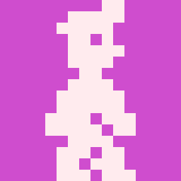

HERO WILLY
=====================
The very first attempt at a game scene in HTML5 and JavaScript — the experiment that grew into the svision library.


## About
Willy was started in December 2022 as a spare-time experiment: could a retro game in the style of Willy from *Manic Miner*, with a story of its own in the spirit of *Pyjamarama*, be built as a plain web page? It is not a remake and it is not finished — it is a single test scene, kept for history.

What the scene shows:
- Willy walking, jumping and climbing stairs (up and down, including jumps)
- Willy turning into a Jetpac spaceman, a car and a plane
- floors, walls, roofs, stairs, conveyors, items and doors
- moving figures: Kate, aliens, a bird, a car and a rocket
- the whole scene loaded from JSON (`data/001.json`)
- on-screen arrows on touch devices
- installable as a PWA (`manifest.webmanifest`)

Everything is built from DOM elements styled with CSS on an 8-pixel grid; there is no `<canvas>` drawing, no worker and no build step. The ideas tried here — objects of the scene as classes, a scene described as data, a fixed-rate loop — were later rewritten from scratch as [svision](https://github.com/mitrenga/svision), the library behind the retro game remakes (*Manic Miner*, *Jet Set Willy*, *Jetpac* and others).

`intro.php` is the original invitation (in Czech) that went out with the first version.


## Controls
- `←` `→` — walk
- `Space` or `↑` — jump
- touch devices: on-screen arrow buttons


## Requirements
- PHP 8.1+
- nginx (or Apache with `mod_rewrite`)

No database, no Node.js and no svision checkout are needed.


## Install
(`~/` below refers to the project root, not your home directory.)
- clone this repository
- configure the web server so that requests for files that do not exist go to `~/index.php` with the request name as the query string — the page itself needs `001.level` (scene data) and `manifest.webmanifest`

  nginx example (project served as `/willy/`):

  ```nginx
  location /willy/ {
      try_files $uri @willy;
  }
  location @willy {
      rewrite ^/willy/(.*)$ /willy/index.php?$1 last;
  }
  location ~ \.php$ {
      include fastcgi_params;
      fastcgi_param SCRIPT_FILENAME $document_root$fastcgi_script_name;
      fastcgi_pass unix:/run/php/php-fpm.sock;
  }
  ```

  Apache: `~/.htaccess` is the configuration used on the original web hosting (forces HTTPS, disables caching, rewrites `manifest.webmanifest`); add the same rule for `001.level`.
- open the project URL in a browser

There is nothing to build: the JavaScript sources in `~/js/` are served directly as ES modules.


## Project layout
- `index.php` — router: `001.level` → `dataLevel.php`, `manifest.webmanifest` → `manifestPage.php`, anything else → `gamePage.php`
- `gamePage.php` — the HTML page with the scene container
- `js/main.js` — start, 60 Hz loop, keyboard and touch input
- `js/canvas.js` — the scene: loads `001.level`, creates the objects and figures, moves them
- `js/*.js` — one class per object or figure (`willy.js`, `kate.js`, `stair-left.js`, …)
- `data/001.json` — the scene description
- `css/`, `images/`, `fonts/`, `media/` — styles, graphics, ZX Spectrum font, music


## License
See the [LICENSE](LICENSE) file.
